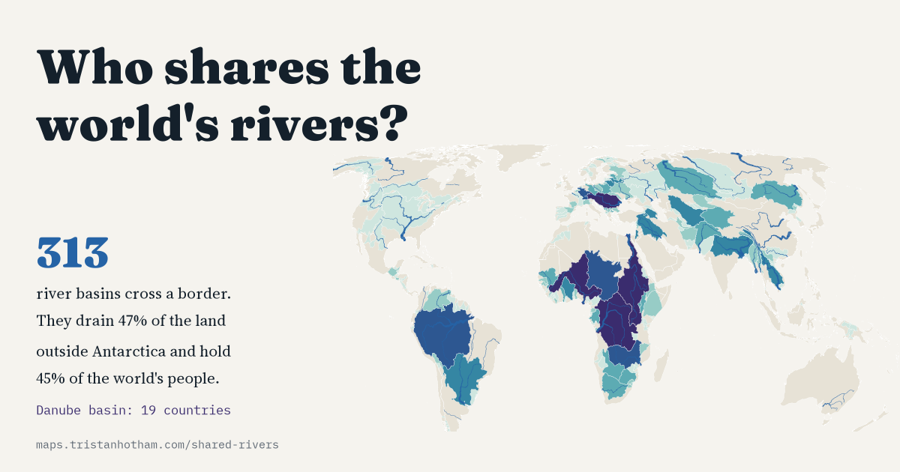

# Who shares the world's rivers?

A world map of the 313 river basins shared by two or more countries, the share of each basin in each country, the rivers that drain them measured end to end on one map, and the countries that depend most on water from upstream. Built from the Transboundary Freshwater Dispute Database (Oregon State University), Natural Earth and FAO AQUASTAT.

Interactive page: https://maps.tristanhotham.com/shared-rivers/
Paper: https://doi.org/10.5281/zenodo.23848927
Blog post: https://blog.tristanhotham.com/2026/10/31/shared-rivers/



## Headline results

- Shared basins: 313 international basins drain 47.1% of the world's land outside Antarctica and held 3.6 billion people in 2022 (45.4% of the world). 235 are shared by two countries and 18 by five or more.
- Most shared: the Danube basin (19 countries), the Nile and the Niger (11 each), the Congo (10) and the Rhine and Meuse (9). Disputed areas listed by the TFDD (such as Abyei or Aksai Chin) are not counted as countries.
- Most populous: the Ganges, Brahmaputra and Meghna basin (849 million people), then the Nile (291 million) and the Indus (245 million). 32 countries have at least 99% of their land in shared basins.
- Longest rivers on one map: measured mouth to most distant source on the Natural Earth 1:10m lines, the Nile (6,151 km), the Yangtze (5,320 km) and the Amazon (5,230 km). These are 82% to 92% of Britannica's lengths and shrink further on coarser lines: the choice of source, mouth and map scale decides the ranking.
- Rivers across borders: the Danube flows through or along 9 countries on the map (the usual count is ten; Moldova's short bank does not register at this scale), the Mekong and the Rhine 6 each.
- Water from abroad (AQUASTAT dependency ratio, 2013 to 2017): more than half of the renewable water comes from outside the country for 38 of 191 countries, including Egypt (97%), Turkmenistan (97%), Hungary (94%), Bangladesh (91%) and the Netherlands (88%).

## Files

| Path | What |
|---|---|
| `index.html` | The interactive page (Leaflet; static, no build step) |
| `data/basins.csv` | 313 international basins: countries (ISO3), disputed areas, area, population 2022 |
| `data/basin_countries.csv` | 812 basin country units: each country's area and share of each basin |
| `data/countries.csv` | Each country's land in shared basins, number of basins, AQUASTAT dependency ratio |
| `data/river_systems.csv` | The 80 longest river systems on the Natural Earth lines: length at 1:10m and 1:50m, path, countries, basin |
| `data/named_rivers.csv` | Named rivers of at least 250 km: map length and countries along the course |
| `data/basins.geojson`, `data/bcu.geojson` | Simplified basin and basin country unit outlines (0.4 MB, 0.9 MB) |
| `data/rivers.geojson`, `data/mainstems.geojson` | River network as used on the page, and the longest path of the 40 longest systems |
| `data/results.json` | Every number quoted on the page, in the paper, blog and Reddit post |
| `code/` | Numbered scripts from the raw files to everything here |
| `release/paper/` | Paper (PDF and LaTeX) and its figures |
| `release/blog/` | Blog post (WordPress block markup), figures and metadata |
| `release/zenodo/` | Files and metadata for the Zenodo record |
| `reddit/` | Collage, the script that draws it, and the post |

## Method

Basins are the TFDD's 2024 register of international basins (countries, area, population) with the 2018 polygons of 310 of them and their basin country units. Countries are sovereign states; the West Bank is counted as Palestine and French Guiana as France. The share of world land is the TFDD basin area over the Natural Earth land outside Antarctica.

Rivers: the 4,224 Natural Earth 1:10m river and lake centrelines are split and joined (tolerance 0.02 degrees) into a network; canals, the Casiquiare, the Ferenc csatorna and the Kovzha are left out so that separate rivers stay separate. Mouths are line ends within 3 km of the sea or of five terminal lakes. Each node is assigned to its nearest mouth (multi-source Dijkstra on geodesic length), delta mouths are merged, and a system's length is the network distance to its most distant source. The same is measured on the 1:50m lines, and on the 1:10m paths simplified at tolerances up to 0.5 degrees. Countries along a river come from points every kilometre (at least 1 km inside, or 5 km within about 1.5 km of a border).

The paper in `release/paper/` sets out every step and limitation.

## Sources and licences

- Transboundary Freshwater Dispute Database, Oregon State University: International River Basins, 2024 basin master table (as published in github.com/SharedWatersLab/geography) and 2018 basins and basin country units (as published in github.com/hannahkfriedrich/tfdd). McCracken, M. and Wolf, A. T. (2019) Updating the Register of International River Basins of the world, International Journal of Water Resources Development 35(5). The TFDD makes its data freely available for research with credit; the derived tables here are shared on the same terms (non-commercial research, credit the TFDD).
- Natural Earth 1:10m and 1:50m rivers and lake centrelines, lakes, land and countries, populated places. Public domain.
- FAO AQUASTAT, as downloaded in 2017 and published in github.com/cmawer/pycon-2017-eda-tutorial. CC BY-NC-SA 3.0 IGO; the dependency ratio column in `data/countries.csv` is under that licence.
- World Bank, World Development Indicators, SP.POP.TOTL. CC BY 4.0.
- Encyclopaedia Britannica, for three published river lengths quoted for comparison (`code/published_lengths.csv`).
- Base map tiles on the page: Esri.

Code: MIT. Text, figures and the remaining derived data: CC BY 4.0. See LICENSE.

## How to rerun

The raw files are read in place from the paths in `code/common.py`. With Python 3, geopandas/shapely 2, networkx, pyproj, scipy, matplotlib and xelatex:

```
cd code
python3 01_basins.py && python3 02_rivers.py && python3 03_results.py && python3 04_site.py
python3 05_figures.py && python3 06_header.py && python3 07_paper.py && python3 08_release.py && python3 09_readme.py
python3 ../reddit/collage.py
```

Set `DOI=10.5281/zenodo.NNN` when running `07_paper.py` and `08_release.py` to print the DOI. `node code/qa.js http://localhost:PORT/` takes screenshots at desktop and phone widths.

## Citation

Hotham, T. (2026) Who shares the world's rivers? International river basins, river lengths measured on one map, and the countries that depend on water from upstream. Zenodo. https://doi.org/10.5281/zenodo.23848927

Tristan Hotham, Independent researcher, ORCID 0000-0003-4931-9349.

I wrote the text, with drafting and editing assistance from Claude (Anthropic), which also helped prepare the analysis code. I reviewed and checked all text and results.
